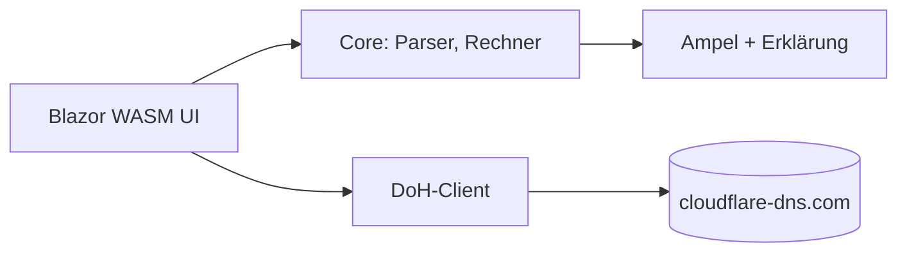

# Admin Toolbox · Konzept

Projekt 2 von 10 im Portfolio von Ömer Tiryaki · Stand 16.11.2026

| | |
|---|---|
| Repo | `tirlogy/admin-toolbox` (öffentlich) |
| Demo | tools.tiryaki.eu |
| Lizenz | MIT |
| Art | Kleineres Projekt (ohne ausführliche Fallstudie) |
| CV-Profil | it-prozesse |
| Geschätzte Dauer | 2 Wochen |

## Kurzbeschreibung
- **DE:** Werkzeuge für IT-Admins im Browser: Mail-Domain-Check, Header-Analyse, Subnetzrechner, DNS-Vergleich und Helfer. Gebaut mit .NET und Blazor WebAssembly.
- **EN:** Browser tools for IT admins: mail domain check, header analysis, subnet calculator, DNS diff and helpers. Built with .NET and Blazor WebAssembly.
- **TR:** BT yöneticileri için tarayıcı araçları: e-posta alan adı kontrolü, başlık analizi, alt ağ hesaplayıcı, DNS karşılaştırma ve yardımcılar. .NET ve Blazor WebAssembly ile geliştirildi.

## Warum dieses Projekt
Zeigt .NET-Kenntnisse und IT-Admin-Wissen (Mail-Sicherheit, DNS, Netzwerke) mit einem Werkzeug, das Ömer selbst täglich nutzen kann, zum Beispiel beim DNS-Umzug von tiryaki.eu.

## Funktionen (verbindlich)
- **Mail-Domain-Check:** MX, SPF (inkl. Auflösung aller includes, Zählung der DNS-Lookups, Limit 10), DKIM (gängige Selektoren testen, eigener Selektor eingebbar), DMARC, BIMI, MTA-STS, TLS-RPT. Ampel, Erklärung und konkreter Verbesserungsvorschlag pro Eintrag
- **Mail-Header-Analyse:** Header einfügen, dann Route als Zeitleiste (Hops, Verzögerungen), SPF/DKIM/DMARC-Ergebnisse, Spam-Hinweise, verdächtige Abweichungen (From vs. Return-Path)
- **Subnetzrechner:** IPv4 und IPv6, CIDR, Netz/Broadcast/Hosts, Aufteilen in Subnetze, Zusammenfassen (Supernetting), Prüfen ob IP im Netz
- **DNS-Vergleich:** Liste „vorher“ (Zonendatei oder Textliste einfügen) gegen Live-Abfrage „nachher“. Zeigt fehlende, geänderte und neue Einträge
- **Helfer (offline):** Passwort- und Passphrasen-Generator mit Stärkeanzeige (kryptografisch sicherer Zufall), JWT-Decoder mit Ablaufprüfung, Base64/URL/Hex-Encoder, Hashes (SHA-1/256/512, MD5 mit Warnhinweis), Zertifikats-Decoder für PEM
- Installierbar als PWA, Helfer funktionieren offline, Verlauf nur lokal

## Nicht im Umfang
- Server-Komponente
- Port-Scans oder aktive Netzwerkscans
- Live-TLS-Prüfung fremder Server (geht aus dem Browser nicht)

## Architektur
Solution:
- `src/AdminToolbox.Core`: reine C#-Bibliothek (Parser für SPF/DMARC/Header, Subnetz-Mathematik, JWT, Zertifikate), keine UI-Abhängigkeit
- `src/AdminToolbox.Dns`: DNS-over-HTTPS-Client (JSON API von Cloudflare `cloudflare-dns.com/dns-query`, Fallback Google DoH), Caching, Timeouts
- `src/AdminToolbox.Web`: Blazor WebAssembly, PWA, Lokalisierung über `.resx` (DE/EN/TR)
- `tests/`: xUnit für Core und Dns (mit aufgezeichneten DoH-Antworten), Playwright für die UI

## Technische Leitplanken
- Aktuelle .NET-LTS-Version, AOT oder Trimming für kleine Bundle-Größe (ADR)
- Blazor-Ladezeit optimieren (Lazy Loading der Werkzeuge, Brotli), Lighthouse-Grenzwerte gelten auch hier
- Keine Eingaben an Dritte außer den DNS-Abfragen, Hinweis im UI

Vorgeschlagener Stack: .NET (LTS), C#, Blazor WebAssembly, PWA, DNS-over-HTTPS, xUnit, Playwright, Cloudflare Pages. Abweichungen sind erlaubt, wenn du sie als ADR begründest.

## Datenmodell
Keine Datenbank. Verlauf und Einstellungen in localStorage über einen kleinen JS-Interop-Service (try/catch).

## Demo
Statisch auf Cloudflare Pages, keine Konten, keine Speicherung auf Servern.

## Recherche-Aufgaben (zuerst erledigen, Ergebnis als ADR)
- Aktuelle .NET-LTS-Version
- Ob die Cloudflare-DoH-JSON-API CORS für Browseraufrufe erlaubt (sonst Google DoH oder per ADR dokumentierte Alternative)
