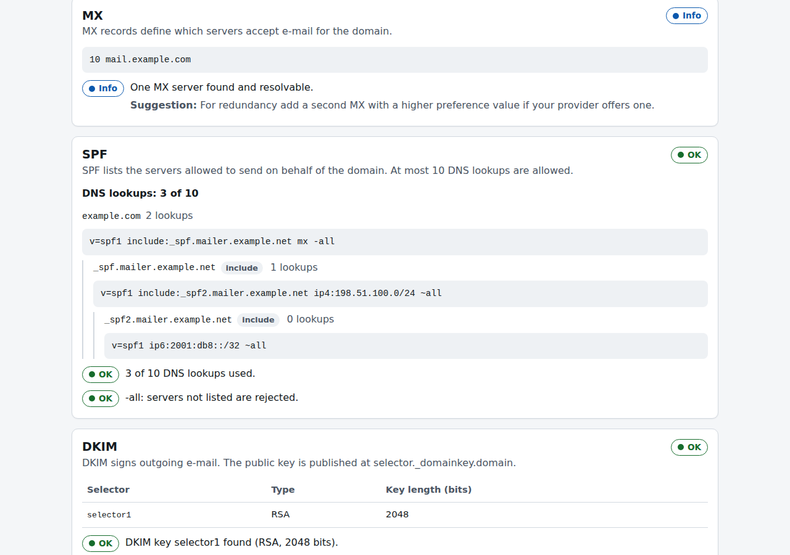

# Admin Toolbox

[](https://github.com/tirlogy/admin-toolbox/actions/workflows/ci.yml)
[](https://github.com/tirlogy/admin-toolbox/actions/workflows/ci.yml)
[](LICENSE)
[](CHANGELOG.md)

Werkzeuge für IT-Admins im Browser: Mail-Domain-Check, Header-Analyse, Subnetzrechner,
DNS-Vergleich und Helfer. Gebaut mit .NET 10 und Blazor WebAssembly. Alles läuft im Browser, nur
DNS-Abfragen verlassen ihn.

**Demo:** https://tools.tiryaki.eu (Vorschau: https://build.admin-toolbox.pages.dev) ·
**English:** [README.md](README.md)



## Funktionen
- **Mail-Domain-Check:** MX, SPF mit Auflösung aller includes und Zählung der DNS-Lookups (Limit 10),
  DKIM (24 gängige Selektoren plus eigener, Schlüssellänge), DMARC, BIMI, MTA-STS und TLS-RPT.
  Ampel, Erklärung und konkreter Verbesserungsvorschlag pro Eintrag.
- **Header-Analyse:** Route als Zeitleiste mit Verzögerungen, SPF/DKIM/DMARC-Ergebnisse,
  Spam-Hinweise, verdächtige Abweichungen (From und Return-Path, Reply-To, Anzeigename).
- **Subnetzrechner:** IPv4 und IPv6, Netz, Broadcast, Hosts, Aufteilen, Zusammenfassen, IP-im-Netz.
- **DNS-Vergleich:** Zonendatei oder Liste von vorher gegen die Live-Abfrage: fehlende, geänderte
  und neue Einträge. Gedacht für DNS-Umzüge.
- **Helfer (offline):** Passwort- und Passphrasen-Generator, JWT-Decoder, Base64/URL/Hex, Hashes,
  Zertifikats-Decoder für PEM.

Installierbar als PWA, Oberfläche auf Deutsch, Englisch und Türkisch, Hell- und Dunkelmodus.
Architektur, Schnellstart und Free-Tier-Limits stehen im englischen [README](README.md).

## Schnellstart

```bash
dotnet test
dotnet run --project src/AdminToolbox.Web
```

## Datenschutz
Keine Server-Komponente, kein Tracking, keine Cookies. Nur die im Mail-Domain-Check und im
DNS-Vergleich eingegebenen Namen gehen als DNS-Abfrage an Cloudflare DNS (Fallback Google Public DNS).

## Lizenz
[MIT](LICENSE) © 2026 Ömer Tiryaki · Built by Ömer Tiryaki · [tiryaki.eu](https://tiryaki.eu)
