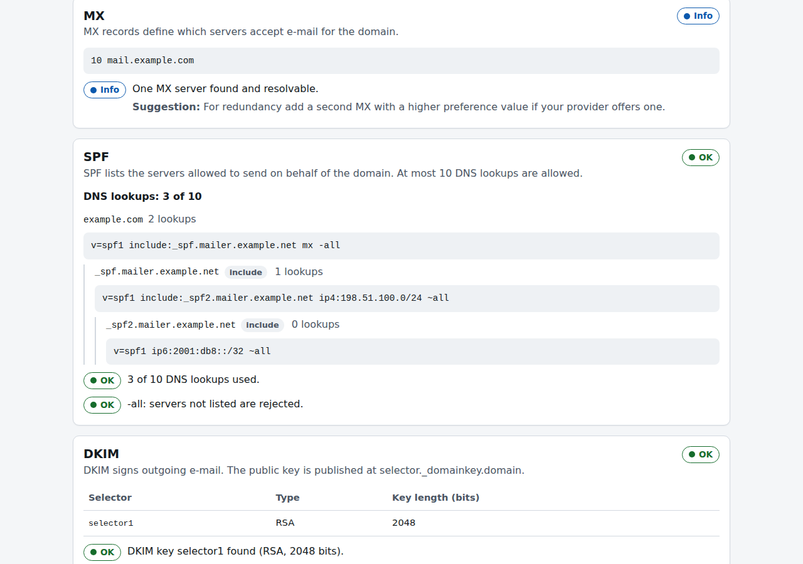
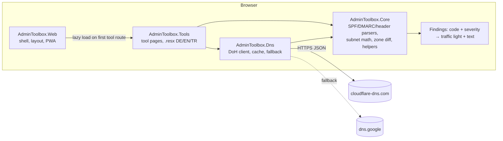

# Admin Toolbox

[](https://github.com/tirlogy/admin-toolbox/actions/workflows/ci.yml)
[](https://github.com/tirlogy/admin-toolbox/actions/workflows/ci.yml)
[](LICENSE)
[](CHANGELOG.md)

Browser tools for IT admins: mail domain check, header analysis, subnet calculator, DNS diff and
helpers. Built with .NET 10 and Blazor WebAssembly. Everything runs in the browser; only DNS
queries leave it.

**Demo:** https://tools.tiryaki.eu (preview: https://tirlogy.github.io/admin-toolbox/) ·
**Deutsch:** [README.de.md](README.de.md)



## Features

| Tool | What it does |
|---|---|
| **Mail domain check** | MX, SPF (resolves every `include`/`redirect`, counts DNS lookups against the limit of 10 and void lookups against 2), DKIM (24 common selectors plus your own, key size), DMARC (incl. organizational domain fallback), BIMI, MTA-STS and TLS-RPT. Traffic light, explanation and a concrete fix per finding. |
| **Header analysis** | Paste raw headers: route as a timeline with delays, SPF/DKIM/DMARC/compauth from `Authentication-Results`, ARC and `Received-SPF`, spam filter verdicts (SpamAssassin, Exchange Online, IONOS, Gmail), suspicious mismatches (Return-Path, Reply-To, display-name spoofing, DKIM alignment). Runs fully offline. |
| **Subnet calculator** | IPv4 and IPv6 with CIDR or netmask: network, broadcast, host range, counts (up to /0 in IPv6), address type, reverse zone, split into subnets, summarize (supernetting), IP-in-network check. Edge cases /0, /31, /32, /127, /128. |
| **DNS diff** | Paste a BIND zone file, a provider export or simple lines (`www CNAME example.com.`) and compare them with live DNS. Shows missing, changed and new values. Built for DNS migrations. |
| **Helpers (offline)** | Password and passphrase generator (crypto RNG, entropy meter), JWT decoder with expiry check, Base64/Base64url/URL/hex, MD5/SHA-1/SHA-256/SHA-512, PEM certificate decoder (SAN, key, usages, fingerprints). |

Installable as a PWA; the helpers and the header analysis work offline. History is stored only in
`localStorage`. UI in German, English and Turkish, light and dark mode.

## Architecture



- `src/AdminToolbox.Core`: pure C# library without UI dependencies. Checks return stable finding
  codes plus arguments; the UI turns them into localized sentences.
- `src/AdminToolbox.Dns`: DNS-over-HTTPS client for the JSON API (Cloudflare, Google fallback),
  per-TTL cache, request de-duplication, 5 s timeout.
- `src/AdminToolbox.Tools`: Razor class library with the tool pages, lazy loaded with Core and Dns.
- `src/AdminToolbox.Web`: Blazor WebAssembly host, service worker, static first paint.
- `tests/`: xUnit for Core and Dns (with recorded DoH answers of real domains), `e2e/`: Playwright
  and Lighthouse CI.

Decisions are documented in [`docs/adr`](docs/adr), the design system in [`docs/DESIGN.md`](docs/DESIGN.md).

## Quick start

Requirements: .NET SDK 10, optional Node.js 24 for the E2E tests.

```bash
git clone https://github.com/tirlogy/admin-toolbox.git
cd admin-toolbox
dotnet test                                    # unit tests with coverage gate in CI
dotnet run --project src/AdminToolbox.Web      # http://localhost:5000 (see console output)
```

Production build and E2E tests:

```bash
dotnet publish src/AdminToolbox.Web -c Release -o publish
cd e2e && npm ci && npx playwright install chromium
npx playwright test        # serves ../publish/wwwroot with the production headers
npx lhci autorun           # Lighthouse, mobile, 3 runs
```

## Configuration

The app has no runtime configuration and no secrets. `src/AdminToolbox.Web/wwwroot/_headers` holds
the security headers (CSP, HSTS, …) for Cloudflare Pages. The DoH endpoints are set in
`DohOptions` (`src/AdminToolbox.Dns/DohClient.cs`); if you change them, update `connect-src` in the CSP.

The CI job "Deploy preview" uploads `build` to Cloudflare Pages when the repository secrets
`CLOUDFLARE_API_TOKEN` and `CLOUDFLARE_ACCOUNT_ID` exist (see [`.env.example`](.env.example));
otherwise it is skipped.

## Quality

- C# with `Nullable` enabled and warnings as errors, `dotnet format` in CI.
- Unit tests: 199 (Core 98 % line coverage, Dns 100 %), CI fails below 80 %.
- E2E: Playwright on desktop and mobile Chrome, under the production CSP, with mocked DNS and an
  offline (service worker) test.
- Lighthouse CI on every push (mobile): performance ≥ 90 and accessibility = 100 on the start page.
- Dependabot for NuGet, npm and GitHub Actions.

## Free tier limits

| Service | Limit | Usage |
|---|---|---|
| Cloudflare Pages (Free) | unlimited static requests and bandwidth, 500 deployments per month, 20 000 files per deployment, 25 MiB per file | about 120 files, largest about 3 MB |
| Cloudflare DNS over HTTPS | no published quota, fair use | one mail check ≈ 40 queries, cached per TTL |
| Google Public DNS (fallback) | per-client rate limits, fair use | only used when Cloudflare fails |
| GitHub Actions | free for public repositories | about 8 minutes per push |

Running cost: **0 €**.

## Privacy

No server component, no tracking, no cookies. DNS names entered in the mail check and DNS diff are
sent to Cloudflare DNS (fallback Google Public DNS). See the in-app privacy page.

## License

[MIT](LICENSE) © 2026 Ömer Tiryaki. The passphrase word list is the
[EFF short word list](https://www.eff.org/dice) (CC BY 3.0 US).

Built by Ömer Tiryaki · [tiryaki.eu](https://tiryaki.eu)
